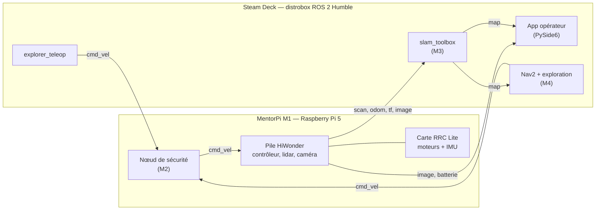

# explorer-1

[](https://github.com/jesasipas/explorer-1/actions/workflows/ci.yml)


[](LICENSE)

**Robot mobile autonome qui explore et cartographie un bâtiment inconnu, piloté depuis un Steam Deck.**

explorer-1 est un projet personnel de robotique : partir d'un robot éducatif à roues Mecanum
(HiWonder MentorPi M1) et construire, brique par brique, un système capable d'explorer seul un
espace intérieur, d'en dresser la carte, d'y **nommer les objets qu'il reconnaît**, puis à terme
de coopérer en essaim.

> **État du projet : jalon M0 (fondations).** Le dépôt repart d'une base propre. Le prototype
> précédent (téléopération, mini-carte lidar) a servi d'apprentissage ; ses leçons sont
> consignées dans [`docs/troubleshooting.md`](docs/troubleshooting.md).

---

## Objectifs

| # | Capacité | Jalon |
|---|---|---|
| 1 | Téléopération sûre depuis le Steam Deck (manette, vidéo, télémétrie, arrêt d'urgence) | M2 |
| 2 | Cartographie 2D en temps réel (SLAM) | M3 |
| 3 | Exploration autonome et retour au point de départ | M4 |
| 4 | Poursuite de la mission en cas de perte de liaison | M5 |
| 5 | Carte sémantique : objets détectés par la caméra et nommés sur la carte | M6 |
| 6 | Plusieurs robots coopérant en essaim | M7 |

Feuille de route détaillée : [`docs/roadmap.md`](docs/roadmap.md).

## Architecture

Pour le prototype, le calcul lourd (SLAM, navigation) tourne **volontairement sur le Steam Deck**
afin de simplifier les tests ; le robot garde les fonctions de sécurité. Les nœuds étant
portables, ils migreront sur le robot avant le jalon M5 ([ADR 0004](docs/decisions/0004-calcul-sur-steam-deck-pour-le-prototype.md)).



Détails : [`docs/architecture.md`](docs/architecture.md).

## Matériel

| Élément | Modèle |
|---|---|
| Robot | HiWonder MentorPi M1, châssis à roues Mecanum |
| Calcul embarqué | Raspberry Pi 5 |
| Sous-contrôleur | Carte RRC Lite (moteurs à encodeurs, IMU, servos), liaison série |
| Lidar | 360°, TOF — modèle exact à confirmer (voir [`docs/hardware.md`](docs/hardware.md)) |
| Caméra | Sur support pan/tilt — type à confirmer |
| Poste opérateur | Steam Deck |

## Logiciels

- **ROS 2 Humble** sur le robot (pile HiWonder) et sur le Steam Deck (conteneur distrobox)
- **Python 3.10** pour le code d'explorer-1 ; C++ seulement si les mesures l'exigent ([ADR 0005](docs/decisions/0005-python-par-defaut.md))
- **slam_toolbox**, **Nav2** pour la cartographie et la navigation
- **PySide6** pour l'interface opérateur ([ADR 0006](docs/decisions/0006-pyside6.md))
- Qualité : ruff, mypy (strict), pytest, pre-commit, GitHub Actions

## Installation

### 1. Cloner et configurer

```bash
git clone https://github.com/jesasipas/explorer-1.git
cd explorer-1
cp config/network.example.yaml config/network.yaml   # puis adapter (fichier ignoré par git)
```

### 2. Outils de développement (n'importe quel PC)

```bash
python3 -m venv .venv && source .venv/bin/activate
pip install -r requirements-dev.txt
pre-commit install
pytest && ruff check . && mypy
```

### 3. Environnement ROS 2 sur le Steam Deck

Voir [`docs/setup-steamdeck.md`](docs/setup-steamdeck.md) (conteneur distrobox) puis :

```bash
cd ros2_ws
colcon build --symlink-install
source install/setup.bash
```

Mise en route du robot : [`docs/setup-robot.md`](docs/setup-robot.md).

## Utilisation

```bash
# Téléopération du robot réel (le remappage vers /controller/cmd_vel est fait dans le launch)
ros2 launch explorer_bringup teleop.launch.py

# Vers un autre robot ou un simulateur
ros2 launch explorer_bringup teleop.launch.py cmd_vel_topic:=/cmd_vel
```

> ⚠️ Premiers essais roues levées. Les index d'axes de la manette sont à vérifier (jalon M2).

## Structure du dépôt

```
explorer-1/
├── config/                 # modèle de configuration réseau (network.yaml reste local)
├── docker/                 # environnement ROS 2 Humble (distrobox)
├── docs/                   # architecture, matériel, mise en route, décisions (ADR), mesures
├── ros2_ws/src/
│   ├── explorer_operator/  # config, logique de téléopération (testée sans ROS), nœud teleop
│   └── explorer_bringup/   # fichiers de lancement et paramètres — frontière matérielle
├── scripts/github/         # création des étiquettes, jalons et issues
└── .github/                # CI, modèles d'issue et de pull request
```

## Contribuer

Les issues et pull requests sont bienvenues. Commits au format
[Conventional Commits](https://www.conventionalcommits.org/fr/), une branche par sujet,
CI verte avant fusion.

## Auteur

**Thomas Blondel** — ingénieur data qui se forme à la robotique et à la vision par ordinateur.
LinkedIn : [TODO : ajouter l'URL du profil]

## Licence

[MIT](LICENSE)
