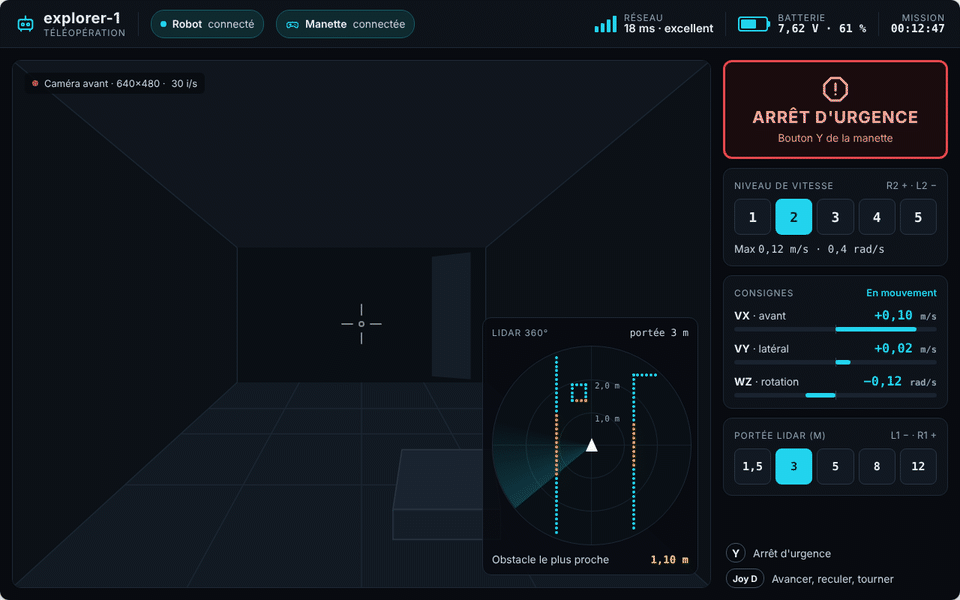
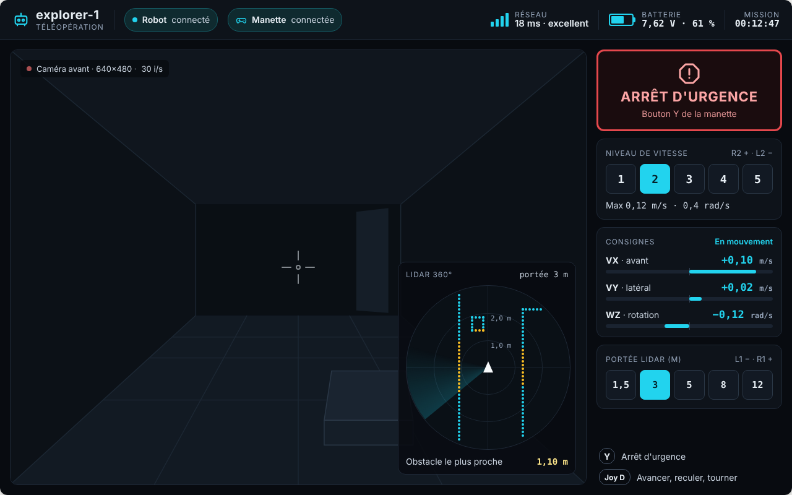
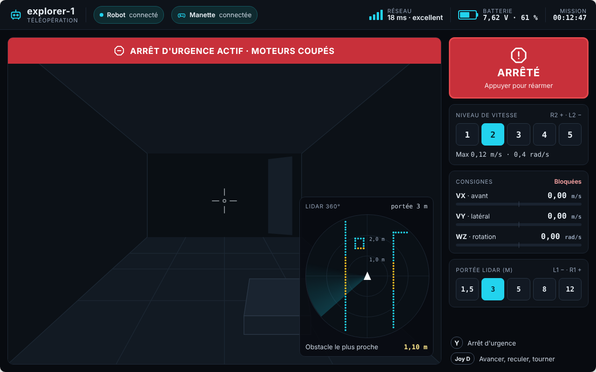
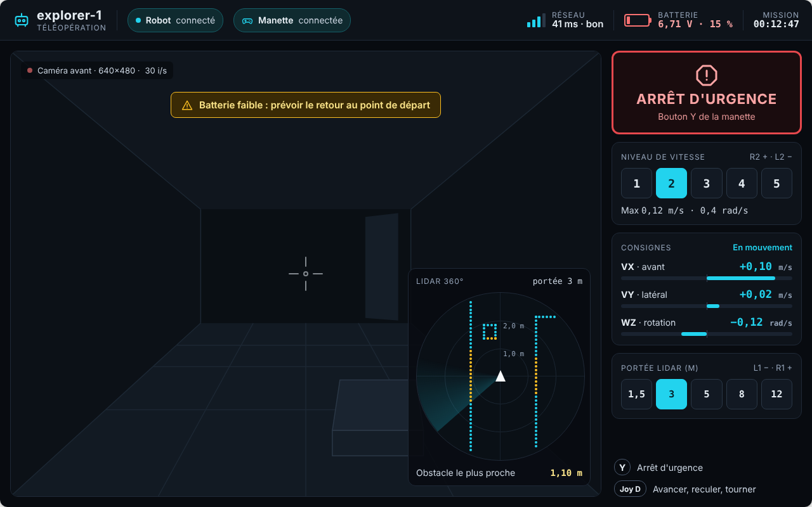
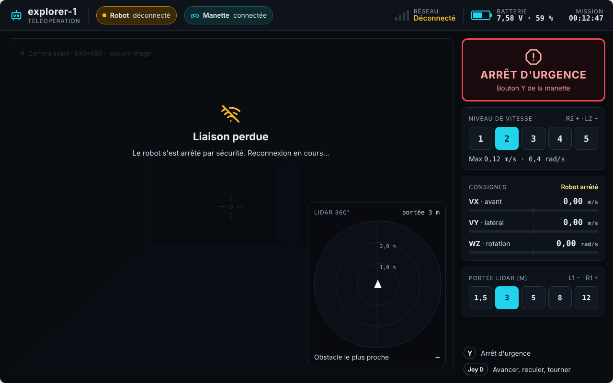
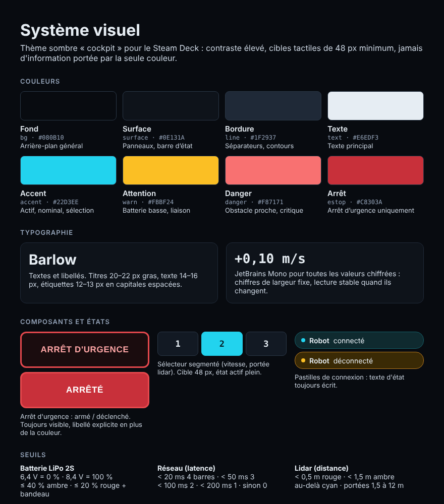

# Maquette de l'interface de contrôle

Maquette de référence de l'application opérateur (jalon M2), conçue pour l'écran du
**Steam Deck (1280×800)**. Elle n'est pas encore codée : cette page sert de spécification à
l'équipe qui réalisera l'interface en PySide6 ([ADR 0006](../decisions/0006-pyside6.md)).

> Valeurs de démonstration uniquement. L'image vidéo est un décor dessiné. Les captures
> peuvent utiliser une police de remplacement si Barlow n'était pas chargée.

## Disposition

| Zone | Contenu |
|---|---|
| Barre d'état (64 px) | Nom du robot, pastilles de connexion **Robot** et **Manette**, qualité **réseau** (4 barres + latence), **batterie** (jauge + tension + %), chronomètre de **mission** |
| Vidéo (zone principale) | Flux caméra, réticule central, étiquette caméra (résolution, images/s), bandeaux d'alerte |
| Mini-carte lidar (en bas à droite de la vidéo) | Rendu sonar 360°, robot au centre orienté vers le haut, 2 cercles de distance, balayage animé, distance de l'obstacle le plus proche |
| Panneau de commande (300 px, à droite) | Arrêt d'urgence, niveau de vitesse 1 à 5, consignes VX / VY / WZ, portée lidar, rappel des commandes manette |

## États

| | |
|---|---|
|  |  |
| **En mouvement** : consignes affichées en cyan, barres centrées sur zéro | **Arrêt d'urgence** : bandeau rouge, bouton plein « ARRÊTÉ », consignes bloquées à 0 |
|  |  |
| **Batterie faible** : jauge rouge, bandeau ambre « prévoir le retour » | **Liaison perdue** : voile sur la vidéo, robot « déconnecté », lidar vide, consignes à 0 |

Autre état : [à l'arrêt](etat-arret.png).

## Comportements

- **Arrêt d'urgence** : prioritaire sur tout. Bouton à l'écran **et** bouton Y de la manette.
  Déclenché, il passe au rouge plein, affiche « Appuyer pour réarmer » et met les consignes à zéro.
- **Niveau de vitesse** (R2 / L2) : 5 niveaux, vitesse maximale = niveau × 0,06 m/s en
  linéaire et niveau × 0,2 rad/s en rotation (niveau 5 : 0,30 m/s et 1,0 rad/s, valeurs
  prudentes de `explorer_bringup/config/teleop.yaml`).
- **Consignes** : barre centrée sur zéro, longueur proportionnelle à la consigne rapportée
  au maximum du niveau ; valeur signée affichée en chiffres à chasse fixe.
- **Portée lidar** (L1 / R1) : 1,5 · 3 · 5 · 8 · 12 m. Les cercles affichent un tiers et deux
  tiers de la portée.

## Seuils

| Indicateur | Règle |
|---|---|
| Batterie LiPo 2S | 6,4 V = 0 % · 8,4 V = 100 % ; ≤ 40 % ambre ; ≤ 20 % rouge + bandeau |
| Réseau (latence) | < 20 ms : 4 barres (excellent) · < 50 ms : 3 (bon) · < 100 ms : 2 (moyen) · < 200 ms : 1 · sinon 0 ; pas de réponse : « Déconnecté » |
| Points lidar | < 0,5 m rouge · < 1,5 m ambre · au-delà cyan |

## Système visuel

| Jeton | Couleur | Rôle |
|---|---|---|
| `bg` | `#080B10` | Arrière-plan |
| `surface` | `#0E131A` | Panneaux, barre d'état |
| `line` | `#1F2937` | Séparateurs, contours |
| `text` | `#E6EDF3` | Texte principal (texte secondaire : `#CBD5E1`, étiquettes : `#94A3B8`) |
| `accent` | `#22D3EE` | Actif, nominal, sélection |
| `warn` | `#FBBF24` | Batterie basse, liaison |
| `danger` | `#F87171` | Obstacle proche, critique |
| `estop` | `#C8303A` | Arrêt d'urgence uniquement (bordure `#E5484D`) |

- Polices : **Barlow** (textes et libellés) et **JetBrains Mono** (toutes les valeurs chiffrées).
- Cibles tactiles d'au moins 48 px ; aucune information portée par la seule couleur (toujours
  un texte, une icône ou une forme en plus).
- Rayons : 12 px (panneaux), 8 px (boutons), pastilles arrondies.

## Source de la maquette

Le dossier [`source/`](source/) contient le balisage de la maquette (format Claude Design,
`.dc.html`). Ce n'est **pas** du code de l'application : il sert de référence exacte pour
les dimensions, couleurs et textes au moment de coder l'interface en PySide6.

## Pour le codage (jalon M2)

- Respecter le contrat de données et les règles de l'équipe interface (aucun import ROS dans
  l'interface, logique séparée de l'affichage, aucun widget modifié hors du thread Qt).
- Reproduire les quatre états ci-dessus avec la source de démonstration, et générer les mêmes
  captures pour comparer.
